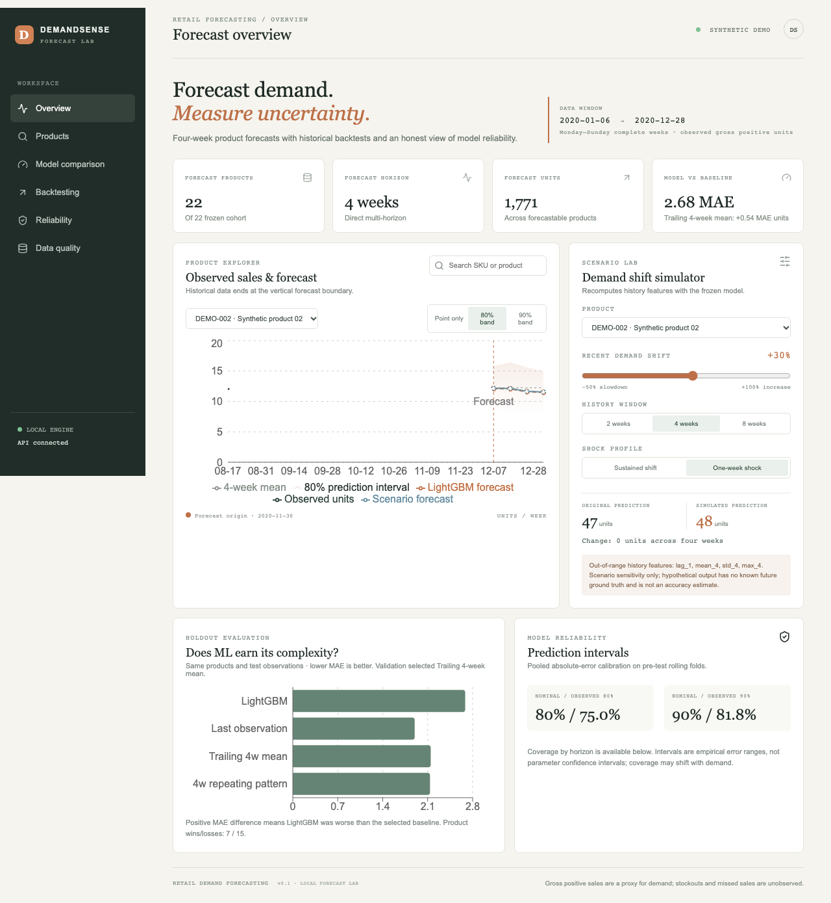
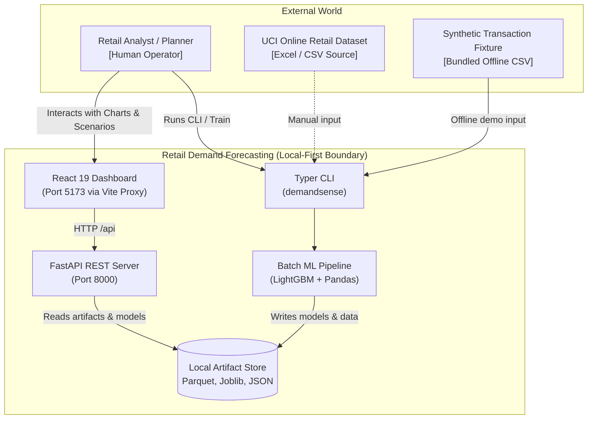
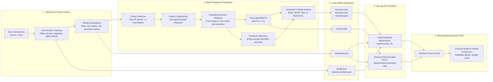
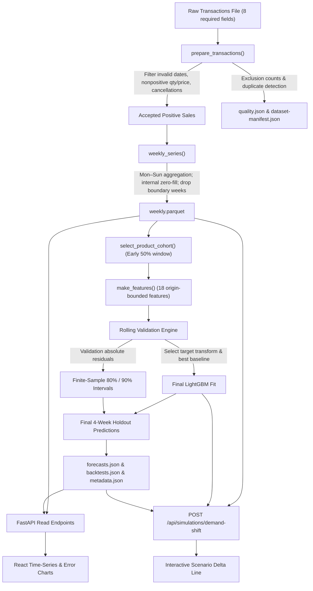
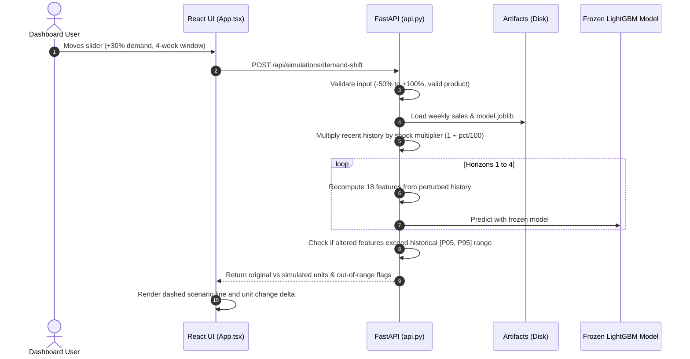
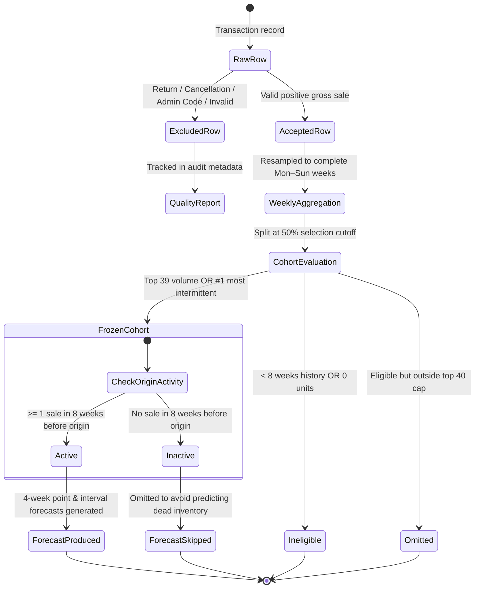

# Retail Demand Forecasting

**Forecast demand. Measure uncertainty. Know when predictions become unreliable.**

Retail Demand Forecasting is a local-first forecasting and model reliability laboratory. It converts transaction records into weekly product sales, compares a pooled LightGBM model with three simple baselines, and exposes chronological holdout results and demand-shift scenarios through a FastAPI API and React dashboard.

Forecasts describe observed gross positive sales. Transaction history does not reveal lost sales during stockouts or unconstrained demand.



The screenshot shows the synthetic demo. The forecast and evaluation values shown in it are calculated from the bundled fixture and are not UCI Online Retail results.

## Capabilities

- Excel/CSV transaction loading, schema validation, conservative cleaning, and an auditable quality report.
- Monday–Sunday weekly aggregation with partial dataset boundary weeks excluded and product histories filled only within observed product activity.
- Direct horizon 1–4 regression with origin-bounded lags/rolling features; last-week, trailing-four-week, and four-week repeating-pattern baselines.
- Chronological final four-week holdout metrics (MAE, WAPE, bias), empirical pre-test residual intervals, persisted model/data artifacts, and local FastAPI serving.
- Dashboard product search, history/forecast comparison, model comparison, and a scenario endpoint that recomputes features using perturbed history.

The repository includes a small, explicitly synthetic transaction fixture for offline exploration. Build its forecasts and measured synthetic-fixture metrics with the demo command below; those results are labeled synthetic and are never presented as UCI results. To reproduce real-data results, provide the UCI workbook and run the full pipeline.

## Architecture and system design

The application implements a **local-first, decoupled, file-artifact-driven architecture**. Analytical model training runs strictly offline via CLI commands, serving queries are fulfilled statelessly by a FastAPI service reading static artifacts on disk, and the React single-page application interacts with the API via a local proxy.

Detailed architecture specifications, component breakdowns, data models, failure handling, and threat analyses are available in the **[Architecture Documentation Suite](docs/architecture/README.md)**.

### 1. System context



* **Local-First & Zero-Database:** Operates completely offline without external databases (PostgreSQL/MongoDB) or message brokers.
* **Separation of Concerns:** Heavy analytical training and lightweight web serving are physically decoupled and communicate strictly through immutable file artifacts.

### 2. High-level architecture



* **Direct Multi-Horizon Strategy:** One pooled LightGBM model forecasts steps $1 \dots 4$ directly, eliminating error accumulation typical of recursive models.
* **Honest Benchmarking:** Evaluates LightGBM against three simple baselines (*Last Observation*, *Trailing 4-Week Mean*, *4-Week Repeating Pattern*) on an untouched 4-week holdout.

### 3. End-to-end data flow



* **Zero Lookahead Leakage:** Features use only history on or before the forecast origin date.
* **In-Span Zero Filling:** Zero sales are inserted only between each product's first and last observed sale, avoiding false assumptions before launch or after discontinuation.
* **Conformal-Style Residual Quantiles:** Prediction intervals use empirical validation residuals rather than theoretical bell-curve (Gaussian) assumptions.

### 4. Demand-shift scenario simulation workflow



* **Instant Sensitivity Testing:** Evaluates the frozen model on features recomputed from shocked history on the fly.
* **Out-of-Distribution Detection:** Flags features that exceed historical 5th–95th percentiles to warn when the model is extrapolating.

### 5. Product lifecycle state machine



* **Pre-Test Freezing:** Products must have at least 8 complete weeks of data in the early 50% timeline to qualify for the cohort.
* **Dead Stock Prevention:** Inactive products (no sales in the 8 weeks before origin) are skipped rather than predicting artificial zeroes.

### Core architectural decisions

| Decision | Implementation | Architectural Rationale |
| :--- | :--- | :--- |
| **Forecasting Paradigm** | **Direct Multi-Horizon** ($h=1..4$) | Eliminates error compounding inherent in recursive 1-step-ahead forecasting. |
| **Model Family** | **Pooled LightGBM** | Learns cross-product dynamics in $<1\text{s}$ CPU training time without heavy GPU or deep learning setup. |
| **Uncertainty Bounds** | **Finite-Sample Residual Quantiles** | Non-parametric empirical error bounds calibrated on holdout folds; avoids Gaussian distribution assumptions. |
| **Persistence Layer** | **Local File Artifacts** (`.parquet`, `.joblib`, `.json`) | Zero-friction local setup without database installation or cloud infrastructure dependencies. |

## Quick start

Requirements: Python 3.12+, uv, Node.js 20.19+ (or 22.13+), and pnpm 12.3.4 (pinned in `apps/web/package.json`). On macOS, install the OpenMP runtime required by LightGBM with `brew install libomp`.

```bash
cd apps/api
uv sync
uv run uvicorn demandsense.main:app --reload
```

In a second terminal:

```bash
cd apps/web
pnpm install
pnpm dev
```

Open <http://localhost:5173>. The API documentation is available at <http://localhost:8000/docs>. Build demo or UCI artifacts before exploring forecasts and evaluation results.

## UCI Online Retail

Download the workbook from the [UCI Online Retail dataset page](https://archive.ics.uci.edu/dataset/352/online+retail) and place it at `data/raw/Online-Retail.xlsx` (the original workbook is intentionally not committed). Citation: Chen, D. (2015). _Online Retail_ [Dataset]. UCI Machine Learning Repository. [https://doi.org/10.24432/C5BW33](https://doi.org/10.24432/C5BW33). UCI lists the dataset under [CC BY 4.0](https://creativecommons.org/licenses/by/4.0/); preserve attribution when sharing adapted or derived data.

```bash
cd apps/api
uv run demandsense pipeline --input ../../data/raw/Online-Retail.xlsx --output ../../artifacts --data-mode "UCI Online Retail"
uv run demandsense inspect --artifacts ../../artifacts
```

The pipeline writes local model, weekly Parquet, forecasts, backtests, quality, data manifest and model metadata artifacts. Source data acquisition is manual so that users can verify the official source and its applicable license/attribution. Cancellations and nonpositive quantities are excluded from gross positive sales and counted in audit metadata. Missing customer IDs do not invalidate an otherwise accepted sales record. Duplicate-looking invoice rows are reported, not automatically removed. Administrative exclusions are limited to a small documented list of non-merchandise codes.

For offline evaluation on synthetic data:

```bash
cd apps/api
uv run demandsense build-demo --output ../../artifacts/demo
RETAIL_DEMAND_FORECASTING_ARTIFACTS=../../artifacts/demo uv run uvicorn demandsense.main:app --reload
```

In another terminal, run `cd apps/web && pnpm install && pnpm dev`. The dashboard identifies the active data mode. The synthetic fixture and generation procedure are described in [`data/demo/README.md`](data/demo/README.md).

## Method and interpretation

The product cohort is selected from the initial half of the complete-week timeline, before validation, requiring at least eight observations and positive units. It includes up to 39 higher-volume products plus the most intermittent eligible product. Validation origins follow the selection cutoff; the latest four complete weeks are held for the final chronological holdout. Forecast features use only sales through their origin, and training labels must be available by the fold cutoff. Products without observed activity through the common final forecast origin do not receive a forecast. No random split is used.

MAE is average weekly unit error. WAPE is total absolute error divided by total absolute actual volume and is unavailable when that denominator is zero. Positive bias means overforecasting. The strongest baseline is selected from pre-test validation. The dashboard compares final holdout results against the baseline family without disguising model underperformance. 80% and 90% residual intervals use finite-sample quantiles, calibrated per horizon when at least 20 validation residuals are available and otherwise using the pooled residuals. They do not guarantee future coverage, especially under a shift.

The demand shift simulator modifies recent weekly history and recomputes features before inference. Its result is a hypothetical sensitivity, not an accuracy estimate. Feature importance is gain-based and describes model reliance, not causation.

## Development

```bash
cd apps/api && uv run pytest
cd ../web && pnpm build
```

CI uses compact unit tests and frontend build checks; it does not download the UCI workbook. To run the browser workflow after building demo artifacts, use `pnpm test:e2e` from `apps/web`. See [methodology](docs/methodology.md), [limitations](docs/limitations.md), [API](docs/api.md), and [model card](docs/model-card.md).

## Limitations

The source spans roughly one year, so it gives weak evidence for annual seasonality. Sales are observed positive units, not true demand; product availability and stockouts are unknown. Sparse products remain difficult. Wholesale spikes can distort the history. Feature importance is not causal. Residual interval calibration may not transfer across distribution shifts. Retail Demand Forecasting does not integrate live transaction or stock data.

## License and contribution

Application code is MIT licensed. The UCI source workbook is not redistributed here. See [CONTRIBUTING.md](CONTRIBUTING.md) and [CODE_OF_CONDUCT.md](CODE_OF_CONDUCT.md).
