# Retail Demand Forecasting

**Forecast demand. Measure uncertainty. Know when predictions become unreliable.**

Retail Demand Forecasting is an open-source, local-first forecasting and model reliability laboratory. It converts transaction records into weekly product sales, trains a pooled LightGBM model alongside three simple statistical baselines, and evaluates chronological holdout metrics and demand-shift scenarios through a high-performance FastAPI service and React dashboard.

Forecasts describe observed gross positive sales. Transaction history does not reveal lost sales during stockouts or unconstrained demand.

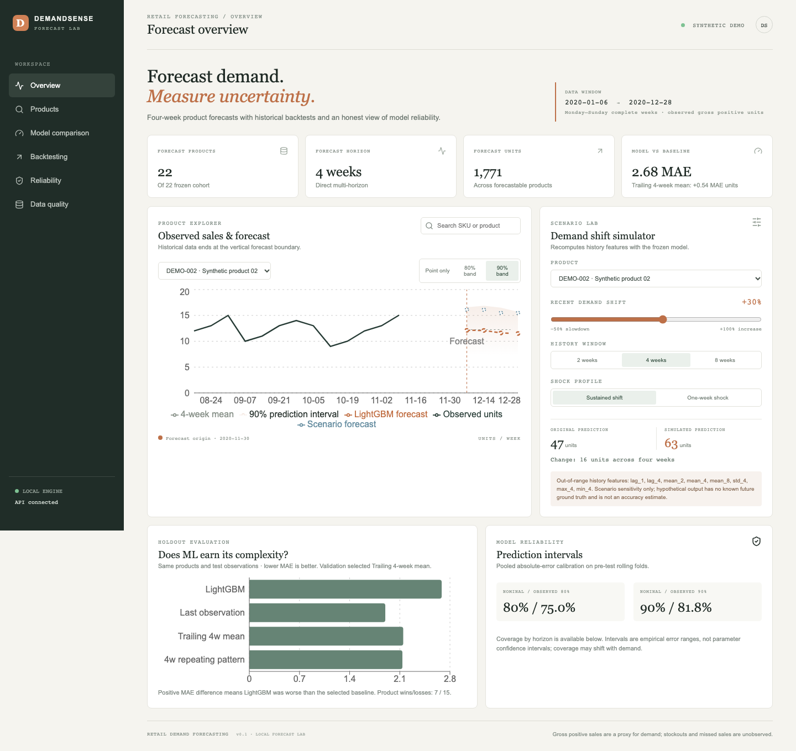
_Retail Demand Forecasting dashboard exploring 4-week forecasts, empirical prediction intervals, and sensitivity scenarios generated on the bundled offline synthetic fixture._

---

## Capabilities

- **Transaction Ingestion & Conservative Cleaning:** Excel/CSV transaction loading, schema validation, non-positive quantity and cancellation filtering, and an auditable data quality report.
- **Monday–Sunday Weekly Aggregation:** Partial dataset boundary weeks are excluded, and product histories are zero-filled only within observed product lifetimes to avoid lookahead or false post-discontinuation assumptions.
- **Direct Multi-Horizon Regression ($h=1..4$):** A pooled LightGBM regressor with 18 origin-bounded lag, rolling, and calendar features evaluated against _Last observation_, _Trailing 4-week mean_, and _4-week repeating pattern_ baselines.
- **Finite-Sample Residual Intervals:** Empirical conformal-style 80% and 90% error bounds calibrated per horizon from pre-test validation residuals rather than theoretical Gaussian assumptions.
- **Interactive Demand-Shift Simulator:** Recomputes feature pipelines dynamically under hypothetical demand shocks with automatic out-of-distribution (historical 5th–95th percentile) boundary detection.
- **Complete Decoupled Architecture:** Offline Typer CLI (`demandsense`) for training, zero-database file-based artifact store (`.parquet`, `.joblib`, `.json`), FastAPI REST backend, and a modern React 19 SPA.

---

## Showcase Gallery

Explore the primary views and operational capabilities of the platform:

### 1. Interactive Demand-Shift Simulator

Recomputes the entire 18-feature pipeline from perturbed historical data in real time, projecting hypothetical model sensitivity with automatic out-of-distribution feature warnings.

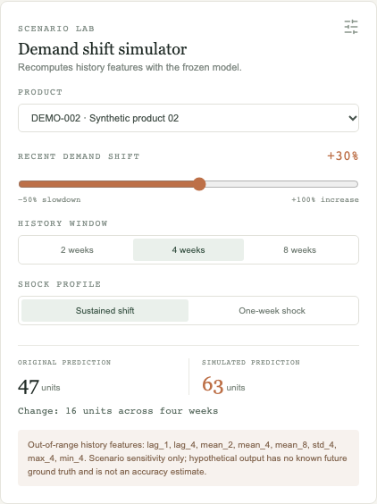

### 2. Product Directory & Cohort Management

Exposes active cohort products with 4-week forecasted volumes, benchmark baselines, and holdout MAE metrics with one-click transition to forecast inspection.

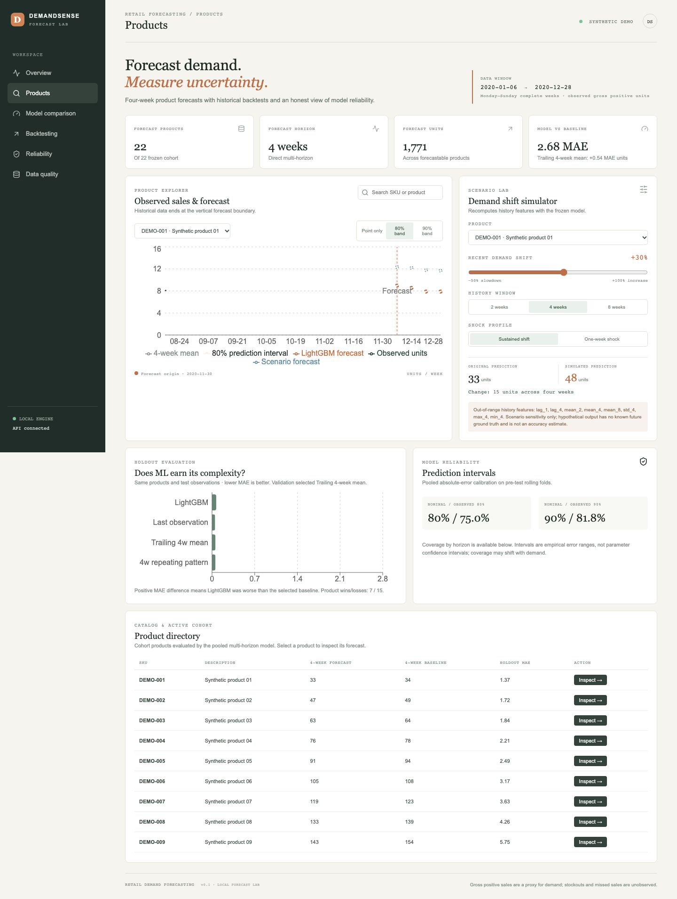

### 3. Model Comparison & Honest Benchmarking

Direct side-by-side holdout evaluation of pooled LightGBM versus statistical baselines, reporting MAE, WAPE, signed bias, horizon breakdown (+1 to +4 weeks), and SKU win/loss rates.

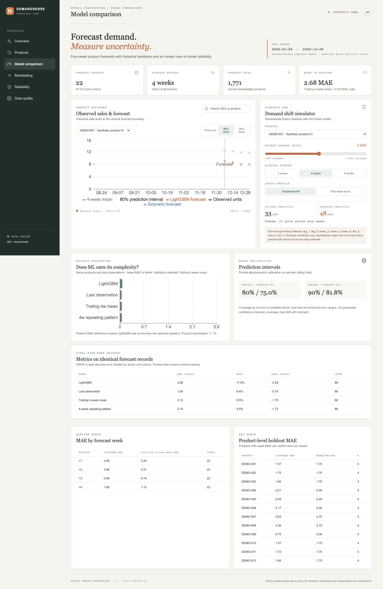

### 4. Reliability & Interval Calibration

Analyzes feature gain rankings with natural-language descriptions alongside nominal versus observed coverage for 80% and 90% prediction intervals across all forecast horizons.


### 5. Chronological Out-of-Sample Backtesting

Granular record-level audit of all predictions across rolling validation folds and the untouched final holdout, filterable by fold and SKU.

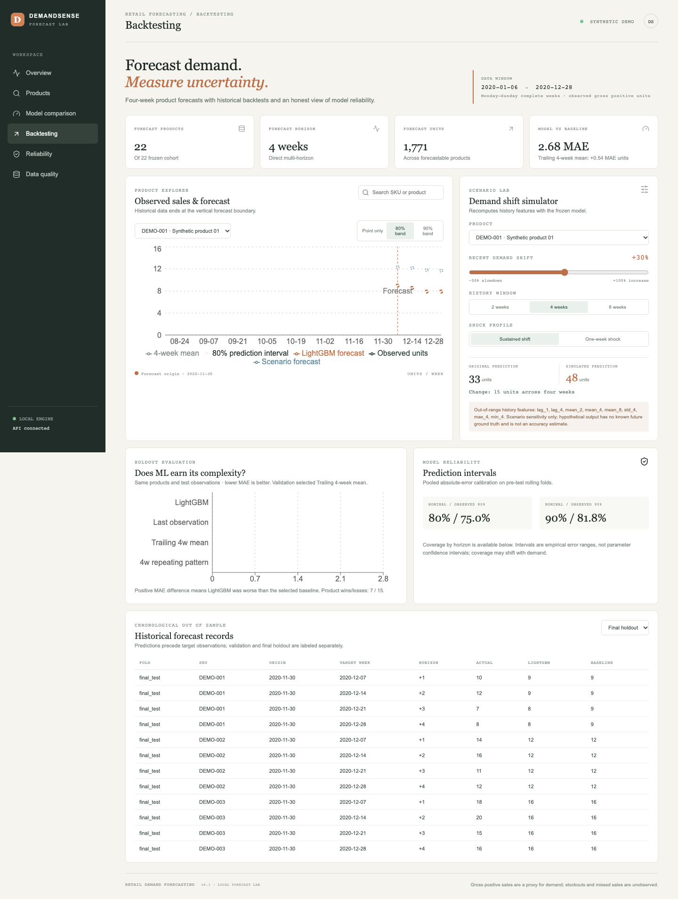

### 6. Ingestion Audit & Data Quality Report

Full auditable report detailing accepted positive rows, cancellations, return codes, non-positive quantities, date boundaries, and data manifest hashes.

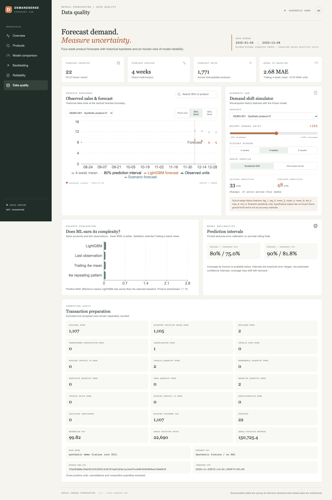

### 7. Typer Command-Line Interface (`demandsense`)

Authentic terminal workflow demonstrating pipeline execution, demo fixture generation, and artifact inspection.

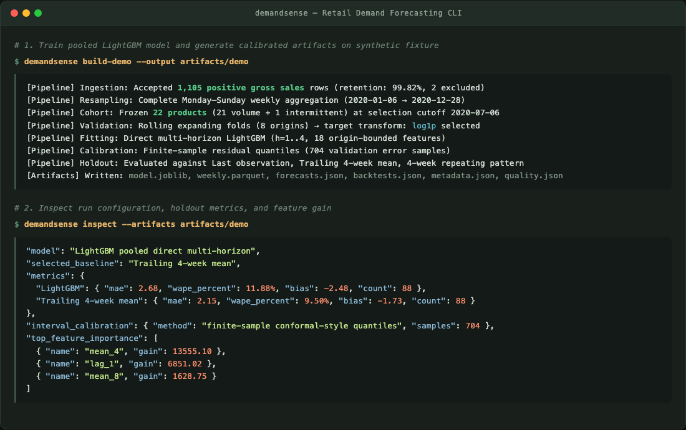

---

## Architecture and System Design

The application implements a **local-first, decoupled, file-artifact-driven architecture**. Analytical model training runs strictly offline via CLI commands, serving queries are fulfilled statelessly by a FastAPI service reading static artifacts on disk, and the React single-page application interacts with the API via a local proxy.

Detailed architecture specifications, component breakdowns, data models, failure handling, and threat analyses are available in the **[Architecture Documentation Suite](docs/architecture/README.md)**.

### 1. System Context

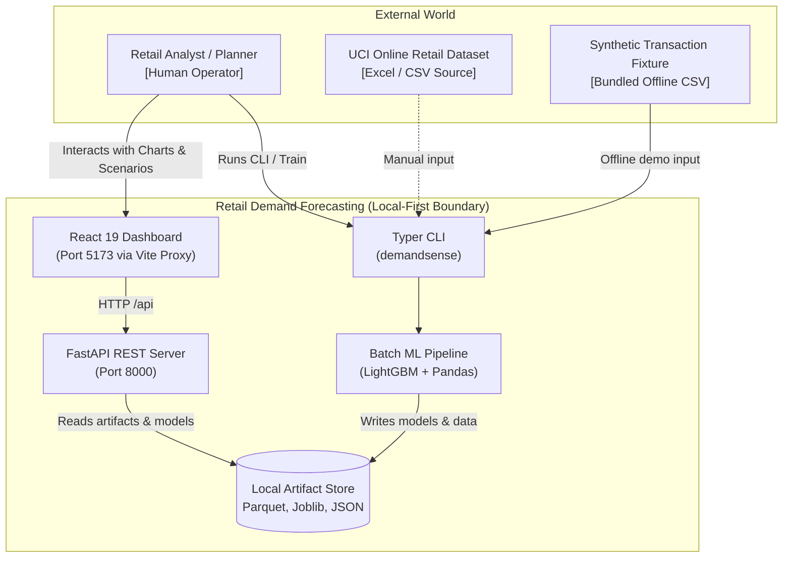

- **Local-First & Zero-Database:** Operates completely offline without external databases (PostgreSQL/MongoDB) or message brokers.
- **Separation of Concerns:** Heavy analytical training and lightweight web serving are physically decoupled and communicate strictly through immutable file artifacts.

### 2. High-Level Architecture

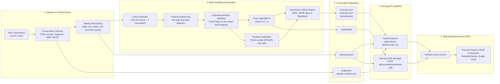

- **Direct Multi-Horizon Strategy:** One pooled LightGBM model forecasts steps $1 \dots 4$ directly, eliminating error accumulation typical of recursive models.
- **Honest Benchmarking:** Evaluates LightGBM against three simple baselines (_Last Observation_, _Trailing 4-Week Mean_, _4-Week Repeating Pattern_) on an untouched 4-week holdout.

### 3. End-to-End Data Flow

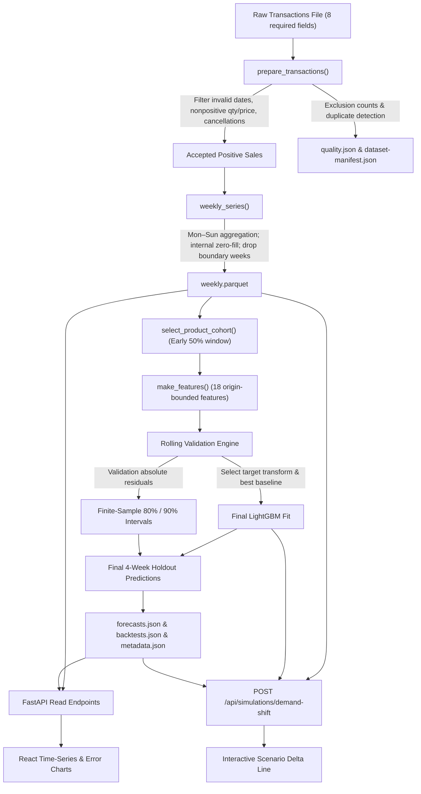

- **Zero Lookahead Leakage:** Features use only history on or before the forecast origin date.
- **In-Span Zero Filling:** Zero sales are inserted only between each product's first and last observed sale, avoiding false assumptions before launch or after discontinuation.
- **Conformal-Style Residual Quantiles:** Prediction intervals use empirical validation residuals rather than theoretical bell-curve (Gaussian) assumptions.

### 4. Demand-Shift Scenario Simulation Workflow

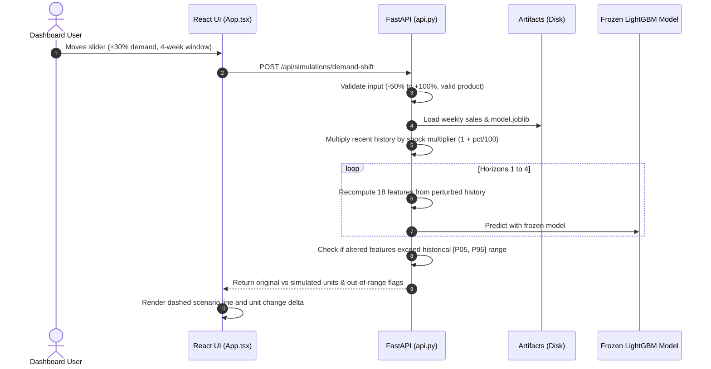

- **Instant Sensitivity Testing:** Evaluates the frozen model on features recomputed from shocked history on the fly.
- **Out-of-Distribution Detection:** Flags features that exceed historical 5th–95th percentiles to warn when the model is extrapolating.

### 5. Product Lifecycle State Machine

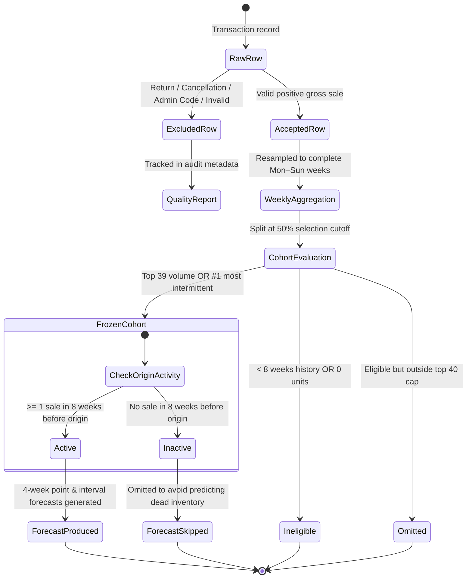

### Core Architectural Decisions

| Decision                 | Implementation                                            | Architectural Rationale                                                                                      |
| :----------------------- | :-------------------------------------------------------- | :----------------------------------------------------------------------------------------------------------- |
| **Forecasting Paradigm** | **Direct Multi-Horizon** ($h=1..4$)                       | Eliminates error compounding inherent in recursive 1-step-ahead forecasting.                                 |
| **Model Family**         | **Pooled LightGBM**                                       | Learns cross-product dynamics in $<1\text{s}$ CPU training time without heavy GPU or deep learning setup.    |
| **Uncertainty Bounds**   | **Finite-Sample Residual Quantiles**                      | Non-parametric empirical error bounds calibrated on holdout folds; avoids Gaussian distribution assumptions. |
| **Persistence Layer**    | **Local File Artifacts** (`.parquet`, `.joblib`, `.json`) | Zero-friction local setup without database installation or cloud infrastructure dependencies.                |

---

## Quick Start

### Prerequisites

- Python 3.12+ and [uv](https://github.com/astral-sh/uv)
- Node.js 20.19+ (or 22.13+) and [pnpm](https://pnpm.io/)
- On macOS, install OpenMP (required by LightGBM): `brew install libomp`

### 1. Build Offline Demo Artifacts

Generate the trained model and serving artifacts from the bundled synthetic transaction fixture:

```bash
cd apps/api
uv sync
uv run demandsense build-demo --output ../../artifacts/demo
```

### 2. Start the Backend API

```bash
RETAIL_DEMAND_FORECASTING_ARTIFACTS=../../artifacts/demo uv run uvicorn demandsense.main:app --reload --port 8000
```

Interactive OpenAPI documentation will be accessible at <http://localhost:8000/docs>.

### 3. Start the Web Dashboard

In a second terminal:

```bash
cd apps/web
pnpm install
pnpm dev
```

Open <http://localhost:5173> to explore forecasts and run simulations.

---

## Real-World Dataset: UCI Online Retail

To train and evaluate on the real-world dataset:

1. Download `Online Retail.xlsx` from the [UCI Machine Learning Repository](https://archive.ics.uci.edu/dataset/352/online+retail) (Citation: Chen, D., 2015, DOI: [10.24432/C5BW33](https://doi.org/10.24432/C5BW33), CC BY 4.0).
2. Save the file to `data/raw/Online-Retail.xlsx` (not committed).
3. Execute the full end-to-end pipeline:

```bash
cd apps/api
uv run demandsense pipeline --input ../../data/raw/Online-Retail.xlsx --output ../../artifacts --data-mode "UCI Online Retail"
uv run demandsense inspect --artifacts ../../artifacts
```

4. Start the backend pointing to the generated artifacts:

```bash
RETAIL_DEMAND_FORECASTING_ARTIFACTS=../../artifacts uv run uvicorn demandsense.main:app --reload --port 8000
```

---

## CLI Reference (`demandsense`)

The command-line interface provides full control over data preparation, training, evaluation, and inspection:

```bash
# Display CLI help
demandsense --help

# Run the complete pipeline on custom transactions
demandsense pipeline --input /path/to/transactions.xlsx --output /path/to/artifacts --data-mode "Custom Store"

# Train on the bundled synthetic fixture
demandsense build-demo --output artifacts/demo

# Inspect persisted run metadata, holdout scores, and quality audits
demandsense inspect --artifacts artifacts/demo
```

---

## Verification and Testing

The repository includes comprehensive unit, integration, and browser end-to-end tests:

```bash
# Run API & pipeline pytest suite
cd apps/api
uv run pytest

# Run Python linter & type checks
uv run ruff check src tests

# Run frontend Vitest unit suite
cd ../web
pnpm test

# Run frontend production build & TypeScript validation
pnpm build

# Run Playwright browser end-to-end suite (spawns local API & web dev server)
pnpm test:e2e
```

---

## Method and Interpretation

- **Cohort Selection:** Selected strictly from the initial 50% training timeline before any validation split, requiring at least 8 complete weeks of data and positive volume. It selects up to 39 high-volume products plus the most intermittent eligible product.
- **Leakage Prevention:** Features use historical transactions strictly on or before the forecast origin date. Training labels must fall within each fold's cutoff. The final four complete weeks are held untouched until final evaluation.
- **Metric Definitions:**
  - $\text{MAE} = \frac{1}{n} \sum |y - \hat{y}|$ (Mean Absolute Error in weekly units).
  - $\text{WAPE} = \frac{\sum |y - \hat{y}|}{\sum |y|}$ (Weighted Absolute Percentage Error).
  - $\text{Signed Bias} = \frac{1}{n} \sum (\hat{y} - y)$ (Positive values indicate overforecasting).
- **Residual Quantile Calibration:** Finite-sample empirical quantiles calibrated per horizon when $\ge 20$ validation residuals are available; otherwise fallback to pooled residuals.
- **Simulation Disclaimer:** The demand shift simulator modifies recent history and recomputes features before inference; results represent hypothetical model sensitivity, not future accuracy guarantees.

---

## Limitations

- **Observed Sales $\neq$ True Demand:** Stockouts, lost sales, and unconstrained market demand are unobserved in transaction logs.
- **Horizon & Seasonality:** The dataset covers approximately one calendar year, providing limited evidence for multi-year seasonal cycles.
- **Distribution Shifts:** Residual intervals calibrated on validation folds may not guarantee coverage during macroeconomic shocks or catalog redesigns.
- **Non-Causal Interpretability:** Feature importance reflects LightGBM split gain (reliance), not causal retail drivers.

---

## Documentation Index

- [Methodology & Temporal Contracts](docs/methodology.md)
- [Feature Registry & Lookback Rules](docs/features.md)
- [Architecture Documentation Suite](docs/architecture/README.md)
- [Dataset Preprocessing & Audit Specifications](docs/dataset.md)
- [REST API Specification](docs/api.md)
- [Model Card](docs/model-card.md)
- [Project Limitations](docs/limitations.md)

---

## License and Contribution

Application code is licensed under the [MIT License](LICENSE). The UCI Online Retail dataset is subject to its original repository license ([CC BY 4.0](https://creativecommons.org/licenses/by/4.0/)). See [CONTRIBUTING.md](CONTRIBUTING.md) and [CODE_OF_CONDUCT.md](CODE_OF_CONDUCT.md).
