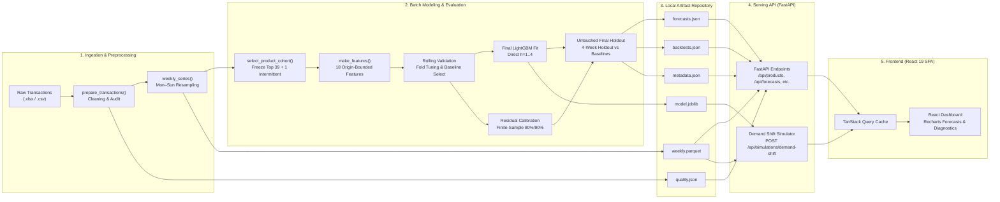

# Architecture Overview

Retail Demand Forecasting is a **local-first retail forecasting and model reliability laboratory**. It turns raw transaction records into weekly product demand forecasts, benchmarks LightGBM against simple baselines, and exposes predictions and real-time sensitivity simulations through a FastAPI backend and React dashboard.

## Key Architectural Principles

1. **Decoupled Batch & Serving:** Heavy data cleaning, rolling validation, and model fitting run offline via the CLI. Serving is lightweight and reads static artifacts from disk.
2. **Zero-Database (File-Artifacts):** Inter-tier communication is mediated by immutable local files in `artifacts/` (`.parquet`, `.joblib`, `.json`), requiring zero external database or cache services.
3. **Direct Multi-Horizon Modeling:** A single pooled LightGBM model forecasts horizons $1 \dots 4$ directly, avoiding recursive error compounding.
4. **Honest Benchmarking:** Compares LightGBM against three simple baselines (*Last Observation*, *Trailing 4-Week Mean*, *4-Week Repeating Pattern*) on an untouched 4-week holdout.
5. **Conformal-Style Residual Bounds:** Prediction intervals are calibrated on validation residuals using finite-sample order statistics rather than assuming Gaussian distributions.

## Architecture Documents

* **[system-context.md](system-context.md)** — External actors, boundaries, and data sources.
* **[high-level-architecture.md](high-level-architecture.md)** — Core subsystems and responsibilities.
* **[component-architecture.md](component-architecture.md)** — Module breakdown across CLI, pipeline, API, and UI.
* **[data-architecture.md](data-architecture.md)** — Data flow, schemas, and 18-feature registry.
* **[execution-flows.md](execution-flows.md)** — Batch training and real-time simulation lifecycles.
* **[deployment-architecture.md](deployment-architecture.md)** — Local processes, network proxying, and CI.
* **[reliability-and-failure-handling.md](reliability-and-failure-handling.md)** — Edge case handling and state transitions.
* **[security-architecture.md](security-architecture.md)** — Threat boundaries, input validation, and Joblib safety.
* **[architectural-decisions.md](architectural-decisions.md)** — Key ADR trade-offs and rationale.
* **[architecture-gaps.md](architecture-gaps.md)** — Known production and scalability limitations.
