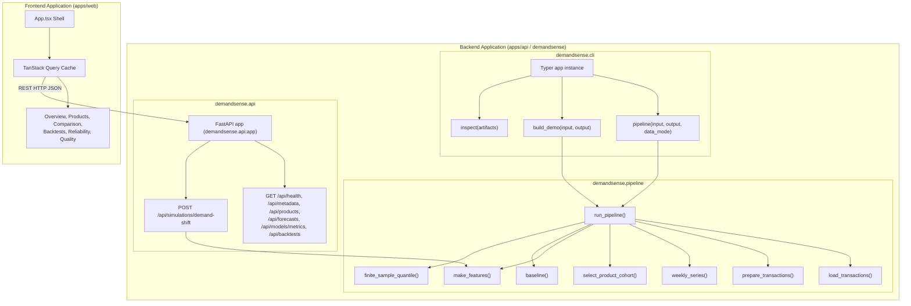

# Component Architecture

Details the internal modules, functions, and interfaces across the backend and frontend.

## Module Responsibilities

### Backend (`apps/api`)
* **`demandsense.cli`:** Typer CLI commands:
  * `pipeline`: Runs full ingestion, training, evaluation, and artifact generation on arbitrary datasets.
  * `build-demo`: Quick-start command running the pipeline on the bundled synthetic fixture.
  * `inspect`: Prints run metadata and quality audits.
* **`demandsense.pipeline`:** Core analytical engine:
  * `load_transactions()` / `prepare_transactions()`: Ingestion and conservative cleaning.
  * `weekly_series()`: Monday–Sunday aggregation, boundary week trimming, in-span zero filling.
  * `select_product_cohort()`: Freezes cohort based strictly on pre-test window.
  * `make_features()`: Extracts 18 origin-bounded features (lags, rolling means, volatility, calendar).
  * `finite_sample_quantile()`: Conformal-style order statistics for prediction intervals.
  * `baseline()`: Implements *naive*, *mean4*, and *repeat4* baselines.
  * `run_pipeline()`: End-to-end orchestrator.
* **`demandsense.api`:** FastAPI endpoints providing read access to artifacts and on-the-fly scenario simulations via `POST /api/simulations/demand-shift`.

### Frontend (`apps/web`)
* **`App.tsx`:** Single-page dashboard shell managing tabs, state, and Recharts components.
* **`metrics.ts`:** Display formatting and empirical interval coverage calculations.
