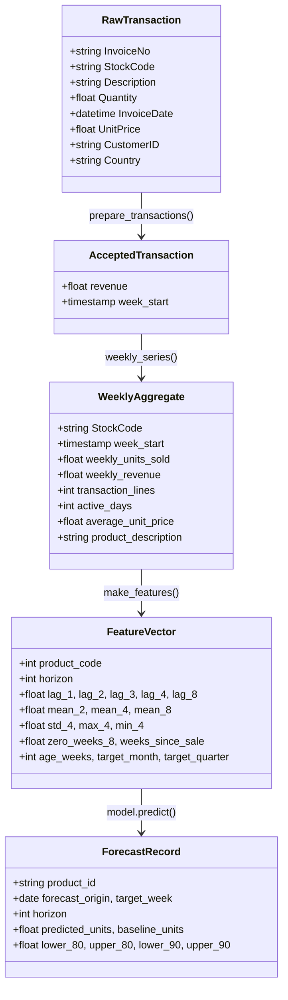

# Data Architecture & Schemas

Details the schemas, cleaning rules, weekly aggregation logic, and the 18-feature engineering contract.

## Data Cleaning & Transformation Rules

1. **Cancellations & Negative Quantities:** Invoices starting with `C`/`c` or lines with `Quantity <= 0` or `UnitPrice <= 0` are excluded from gross sales and recorded in `quality.json`.
2. **Administrative SKUs:** Fixed non-merchandise codes (`POST`, `DOT`, `M`, `C2`, `BANK CHARGES`) are removed.
3. **Incomplete Boundary Weeks:** Global boundary weeks (first and last weeks of the dataset if partial) are dropped to prevent partial-week sales dips.
4. **In-Span Zero Filling:** Zero sales are filled **only** between a product's first and last observed sale. The system intentionally avoids padding zeroes prior to product launch or after discontinuation.

## The 18-Feature Registry

All features derived from sales are strictly origin-bounded (using data $\le \text{origin}$) to prevent lookahead leakage.

| Feature Name | Type | Lookback | Purpose |
| :--- | :--- | :--- | :--- |
| `product_code` | Categorical | None | Categorical SKU identifier in pooled model |
| `horizon` | Integer | None | Step-ahead forecast distance ($h \in \{1, 2, 3, 4\}$) |
| `lag_1`, `lag_2`, `lag_3`, `lag_4`, `lag_8` | Numeric | 1–8 weeks | Point historical sales at specific past intervals |
| `mean_2`, `mean_4`, `mean_8` | Numeric | 2–8 weeks | Short, medium, and long-term trailing average sales |
| `std_4`, `max_4`, `min_4` | Numeric | 4 weeks | Trailing 4-week demand volatility, peak, and trough |
| `zero_weeks_8` | Integer | 8 weeks | Count of zero-sales weeks (demand intermittency) |
| `weeks_since_sale` | Integer | Variable | Weeks elapsed since the latest positive sale |
| `age_weeks` | Integer | Lifetime | Weeks observed since product introduction |
| `target_month`, `target_quarter` | Integer | Calendar | Target calendar month ($1 \dots 12$) and quarter ($1 \dots 4$) |
