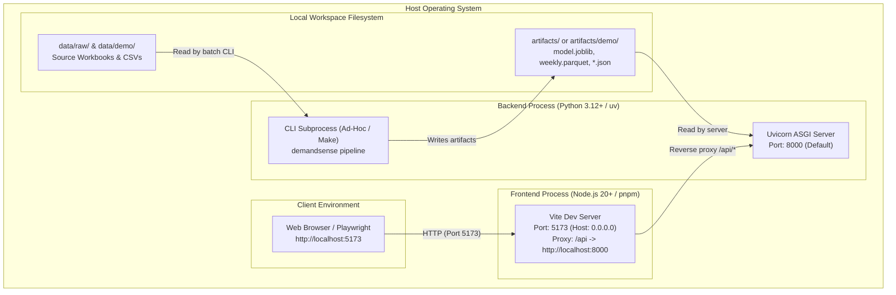

# Deployment Architecture & Environment Topology

Details the local-first multi-process topology, network configuration, and CI workflows.

## Runtime Configuration

* **Backend API:** FastAPI running under Uvicorn on `http://localhost:8000`. Configured via `RETAIL_DEMAND_FORECASTING_ARTIFACTS` (defaults to `artifacts/`).
* **Frontend Web:** Vite development server running on `http://localhost:5173`. Proxies `/api` calls to `http://localhost:8000` to prevent CORS issues. Production assets build to `apps/web/dist/`.
* **CI Workflow (`.github/workflows/ci.yml`):**
  * `python`: Runs `ruff check` and `pytest`.
  * `frontend`: Builds demo artifacts using the synthetic fixture, builds the React app, lints, runs unit tests, and executes Playwright end-to-end tests on Chromium.
