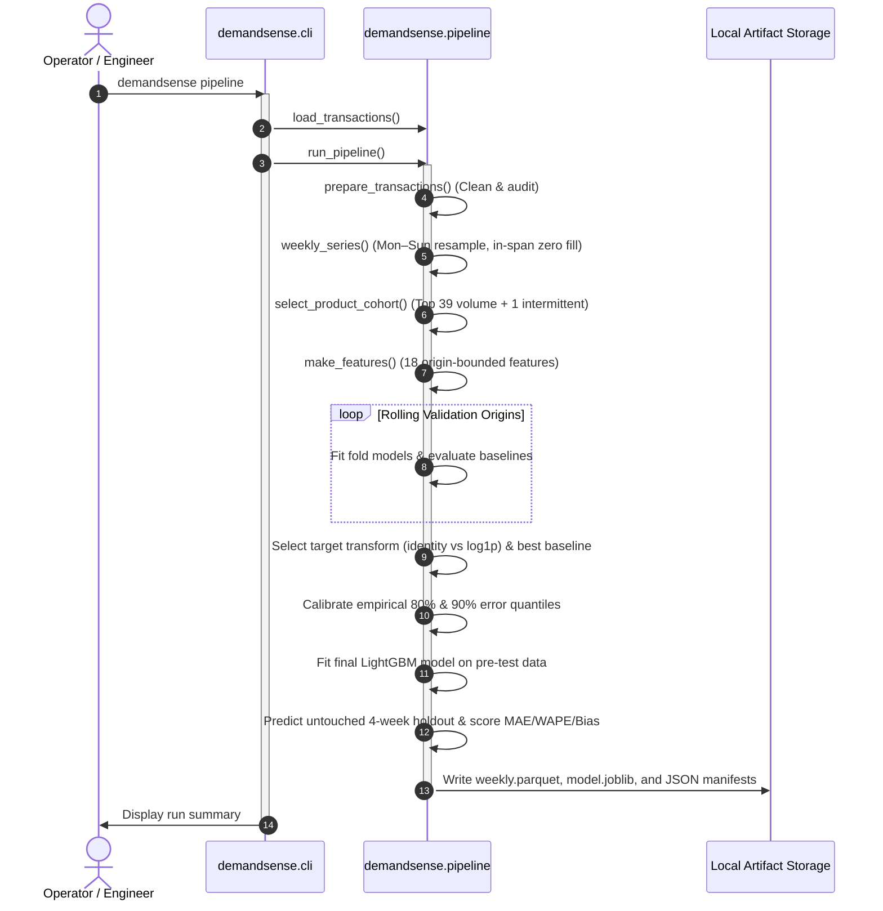
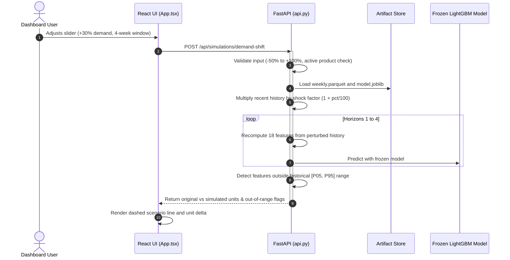

# Execution Flows & Runtime Lifecycles

Traces the primary execution paths across the batch training pipeline and online simulation.

---

## 1. Batch Pipeline Execution Flow

---

## 2. Demand-Shift Scenario Simulation Flow

