# High-Level Architecture

The system implements a **Decoupled, File-Artifact-Driven Modular Architecture**. Heavy analytical processing is isolated from lightweight online serving.

```mermaid
flowchart LR
    subgraph S1["1. Ingestion & Preprocessing"]
        Raw["Raw Transactions<br/>(XLSX / CSV)"] --> Clean["Conservative Cleaning<br/>(Filter cancels, negatives, admin SKUs)"]
        Clean --> Resample["Weekly Resampling<br/>(Mon–Sun weeks, trim boundary weeks)"]
    end

    subgraph S2["2. Batch Modeling & Evaluation"]
        Resample --> Cohort["Cohort Selection<br/>(Top 39 volume + 1 intermittent)"]
        Cohort --> Feat["Feature Engineering<br/>(18 origin-bounded features)"]
        Feat --> Val["Expanding-Window Validation<br/>(Tune log1p vs raw, select best baseline)"]
        Val --> Train["Final LightGBM Fit<br/>(Direct h=1..4)"]
        Val --> Calib["Residual Calibration<br/>(Finite-sample 80%/90% intervals)"]
        Train & Calib --> Holdout["Untouched 4-Week Holdout<br/>(MAE, WAPE, Bias vs Baselines)"]
    end

    subgraph S3["3. Local Artifact Repository"]
        Resample --> Parquet["weekly.parquet"]
        Train --> Model["model.joblib"]
        Holdout --> Results["forecasts.json<br/>backtests.json<br/>metadata.json"]
        Clean --> Quality["quality.json<br/>dataset-manifest.json"]
    end

    subgraph S4["4. Serving API (FastAPI)"]
        Parquet & Results & Quality --> Endpoints["Read Endpoints<br/>/api/products, /api/forecasts, etc."]
        Model & Parquet --> Simulator["Demand Shift Simulator<br/>POST /api/simulations/demand-shift"]
    end

    subgraph S5["5. Web Dashboard (React 19 SPA)"]
        Endpoints --> QueryCache["TanStack Query Cache"]
        Simulator --> QueryCache
        QueryCache --> Views["Forecast Explorer, Model Comparison,<br/>Reliability Bands, Quality Audit"]
    end
```

## Core Subsystems

1. **Ingestion & Preprocessing:** Loads `.xlsx` or `.csv` files, enforces required column schemas, removes cancellations and non-merchandise administrative codes, generates an auditable data quality report, and aggregates transactions to Monday–Sunday complete weeks.
2. **Batch Modeling & Evaluation:** Selects an inspectable cohort (up to 39 high-volume SKUs + 1 intermittent SKU) from early data, constructs 18 origin-bounded features, runs expanding-window rolling validation, fits a pooled LightGBM regressor for horizons $1 \dots 4$, calibrates empirical error quantiles, and scores against an untouched 4-week holdout.
3. **Artifact Repository (`artifacts/`):** Persists all results to local files (`weekly.parquet`, `model.joblib`, `forecasts.json`, `backtests.json`, `metadata.json`, `quality.json`), eliminating database overhead.
4. **FastAPI Serving Engine:** Delivers fast read-only queries from disk and provides a real-time `/api/simulations/demand-shift` endpoint that perturbs recent history and runs dynamic inference without retraining.
5. **React Dashboard:** A client-side Single-Page Application (SPA) using Recharts and TanStack Query for interactive exploration, model comparisons, and scenario planning.
