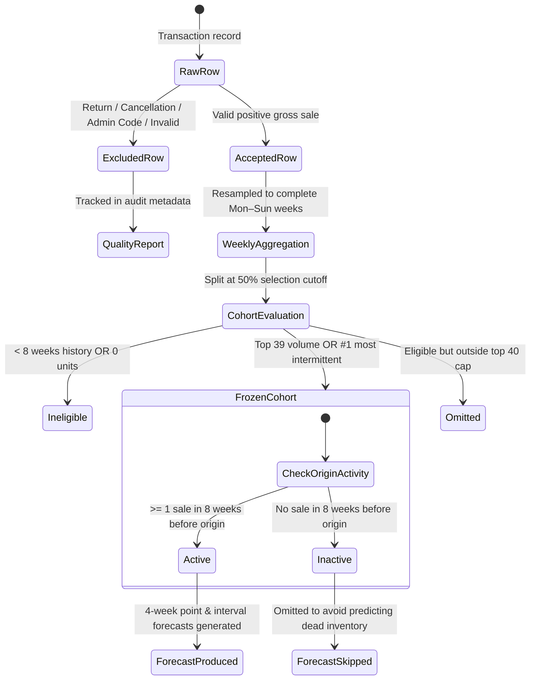

# Reliability & Failure Handling

Details how the system manages edge cases, missing files, and data anomalies.

## Defensive Guards & Error Handling

1. **Missing Artifacts (HTTP 503):** If the API starts before the pipeline runs, endpoints return HTTP 503 with instructions. The dashboard shows a guided setup notice instead of crashing.
2. **Missing & Dead SKUs (HTTP 404 & 422):** Unknown SKUs return 404. In scenario simulations, products without a positive sale in the 8 weeks leading up to origin return 422 to prevent generating meaningless predictions on dead inventory.
3. **WAPE Zero-Denominator Guard:** When calculating Weighted Absolute Percentage Error ($WAPE = \frac{\sum |y - \hat{y}|}{\sum |y|}$), if actual sales sum to zero, the metric gracefully returns `null` with an explanatory reason.
4. **Non-Negative Bound Clamping:** Empirical residual lower bounds are clamped with $\max(0, \hat{y} - q)$ to ensure physical unit predictions never drop below zero.
5. **Out-of-Range Simulation Warning:** The simulator flags features that deviate beyond historical 5th–95th percentiles to warn when extreme user shocks push the model into uncharted extrapolation territory.
