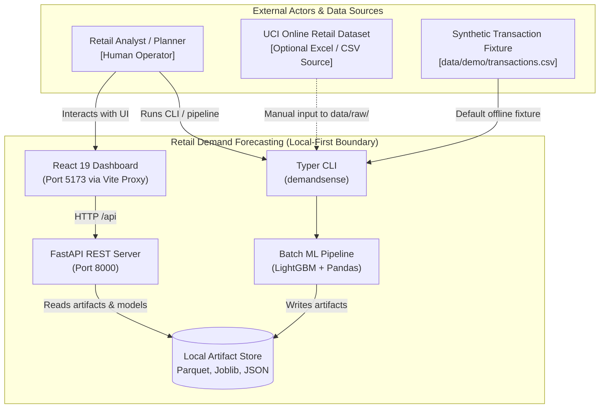

# System Context & Boundaries

Describes the boundaries of Retail Demand Forecasting, external actors, inputs, and environment integration.

## System Entities

* **Retail Analyst [Operator]:** Runs CLI commands (`pipeline`, `build-demo`, `inspect`) to process data and train models; uses the dashboard to inspect forecasts, evaluation metrics, and run scenario simulations.
* **Data Sources:** 
  * *UCI Online Retail Dataset:* Manual download placed at `data/raw/Online-Retail.xlsx` for real-data reproduction.
  * *Synthetic Demo Fixture:* Bundled offline CSV at `data/demo/transactions.csv` for immediate local exploration and CI testing.
* **Local-First Boundary:** Operates completely offline without external databases (PostgreSQL/MySQL), cloud microservices, or external network requests.
